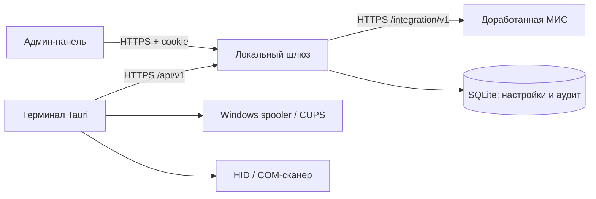
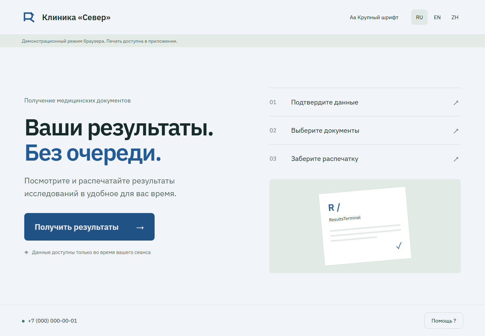

# ResultsTerminal

Настраиваемый терминал выдачи медицинских PDF для разных учреждений. React / Tauri 2, локальный Fastify-шлюз и административная панель. МИС реализует опубликованный контракт; оформление и подключение меняются без пересборки терминала.

**В составе:** восемь способов входа, PDF-предпросмотр и последовательная печать, RU/EN/ZH, темы, регистрация и отзыв терминалов, настройки оборудования, мониторинг терминала/сканера/принтера, синтетическая демо-МИС и проверка совместимости.

Снимки, DICOM, PACS и запись на съёмные носители не входят в продукт.

## Быстрый запуск на синтетических данных

Нужны Node.js **24 LTS** и pnpm **11.25.0**. Физическое оборудование для браузерной демонстрации не нужно.

```sh
pnpm install --frozen-lockfile
pnpm dev
```

1. Откройте [панель учреждения](http://127.0.0.1:5174/admin/).
2. Создайте администратора с паролем от 12 символов. Код **только локального демо**: `demo-setup-local`.
3. В разделе «Терминалы» создайте одноразовый код, действующий 10 минут.
4. Откройте [терминал](http://127.0.0.1:5173/), введите адрес `http://127.0.0.1:8787` и созданный код.
5. Выберите ОМС + дату рождения: ОМС `0000000000000001`, дата `2000-01-01`.

Браузерная демонстрация не отправляет задания принтеру. Учётные данные терминала в ней существуют только в памяти вкладки; после обновления требуется новая регистрация. В установленном приложении они хранятся нативной частью и не доступны JavaScript.

Для остальных способов включите их в «Получение результатов»:

| Способ | Синтетические данные |
| --- | --- |
| ОМС + ФИО | `0000000000000001`, `Тестовый Пациент` |
| Штрихкод / QR | `DEMO-ACCESS-0001` |
| Заказ / договор / ID пациента | `000001`, код `246810` |
| Телефон / OTP | `+79990000000`, код `123456` |

Все записи и PDF демонстрационные и не являются медицинскими данными. Настройки демо сохраняются в игнорируемой папке `var/`.

## Архитектура



- `apps/terminal` — новый интерфейс, аппаратная часть Rust и нативные учётные данные.
- `apps/gateway` — авторизация, конфигурация, сессии и проксирование запросов МИС.
- `apps/admin` — администрирование учреждения и мониторинг устройств.
- `apps/demo-mis` — референсная реализация контракта на синтетических данных.
- `packages/contracts` — схемы, общие типы, конфигурация и темы.

Шлюз обслуживает одно учреждение. Терминалы имеют отдельные отзываемые ключи. PDF не сохраняются в базе; списки результатов и сессии — только в памяти. Передача PDF ограничена 25 МиБ на документ; текущая реализация буферизует его в памяти для проверки заголовка и размера перед выдачей.

## Проверки и сборка

```sh
pnpm test
pnpm typecheck
pnpm build
pnpm format:check
pnpm openapi
pnpm contract:check
pnpm test:browser
cargo test --locked --manifest-path apps/terminal/src-tauri/Cargo.toml --lib
cargo test --manifest-path apps/terminal/src-tauri/crates/oms_parser/Cargo.toml
cargo fmt --manifest-path apps/terminal/src-tauri/Cargo.toml --check
```

Browser tests используют Edge на Windows и Chromium на Linux. На новом Linux-стенде установите тестовый браузер через `pnpm exec playwright install --with-deps chromium`.

Нативный запуск: `pnpm --filter @rt/terminal tauri dev` (шлюз и демо уже должны работать через `pnpm dev`; при занятом 5173 остановите браузерный dev или запускайте backend отдельно по инструкции). Windows-пакет: `pnpm --filter @rt/terminal tauri build --bundles nsis --ci`. Linux-пакет: аналогичная команда с `--bundles deb` на Debian 12. Не собирать Linux DEB на более новой glibc-базе для старой целевой ОС.

## Внедрение и интеграция

- [Руководство разработчика МИС](docs/integration.md)
- [OpenAPI МИС](docs/openapi/integration.json) и [OpenAPI терминала](docs/openapi/terminal.json)
- [Установка и эксплуатация](docs/deployment.md)
- [Администрирование и мониторинг](docs/administration.md)
- [Матрица проверок и ограничения](docs/verification.md)
- [Безопасность](docs/security.md), [происхождение кода и лицензии](THIRD_PARTY_NOTICES.md)

Продукт предназначен для интеграции через API. Работа с конкретной МИС и оборудованием подтверждается отдельной приёмкой; сведения о выполненных локальных проверках находятся в `docs/verification.md`.


